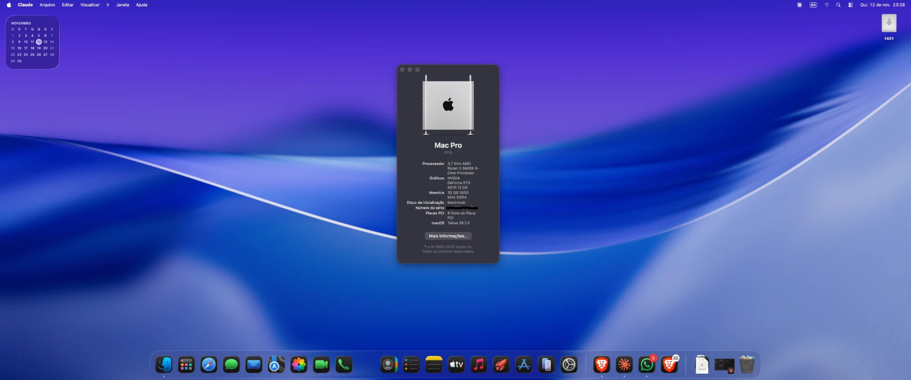

<div align="center">

# Hackintosh · ASRock B550M · Ryzen 5 5600X · RTX 5070

**macOS Tahoe 26.7.3 on AMD Zen 3 with a Blackwell GeForce, Metal acceleration and sharp HiDPI scaling on an ultrawide display**




</div>

---

## Overview

This repository documents a working OpenCore build for an **ASRock B550M** board with a **Ryzen 5 5600X** and an
**NVIDIA GeForce RTX 5070** running **macOS Tahoe 26.7.3**. The NVIDIA card is driven by the community
[**NullMoth NVIDIA driver for macOS**](https://github.com/nullmoth/nvidia-macos-driver), which provides Metal
acceleration for Turing and newer GeForce cards.

It also documents an experiment that worked on this machine: **adding HiDPI ("looks like") resolutions on a
3440×1440 ultrawide without losing sharpness**. That took a corrected display override and a small patch to the
driver's framebuffer kext, both included here with the full investigation.

> [!IMPORTANT]
> **Always prefer the official NullMoth driver releases.** The patch in [`driver-patch/`](driver-patch) is a
> personal experiment built against release 2.9. Upstream releases receive fixes, security updates and new
> hardware support that this patch does not. Updating the driver through the 1401 app replaces the patched kext,
> which is the intended behaviour.

## Contents

| Path | What it is |
|---|---|
| [`EFI.zip`](EFI.zip) | The sanitized OpenCore EFI folder (serial numbers removed, see [Installation](docs/INSTALLATION.md)) |
| [`hidpi/`](hidpi) | Display override that adds HiDPI modes, its installer and two diagnostic tools |
| [`driver-patch/`](driver-patch) | Patch for the NullMoth NVRMFB kext, a reproducible build script, installer and restore script |
| [`docs/INSTALLATION.md`](docs/INSTALLATION.md) | How to use the EFI: SMBIOS generation, BIOS, boot-args, driver installation |
| [`docs/HIDPI.md`](docs/HIDPI.md) | The HiDPI investigation step by step, with the evidence for each finding |
| [`docs/PERFORMANCE.md`](docs/PERFORMANCE.md) | CPU and GPU measurements taken on this build |

## Hardware

| Component | Model | Notes |
|---|---|---|
| Motherboard | ASRock B550M | Resizable BAR enabled (BAR1 = 8 GB) |
| CPU | AMD Ryzen 5 5600X (6C/12T, Zen 3) | AMD vanilla kernel patches, `ProvideCurrentCpuInfo` |
| GPU | NVIDIA GeForce RTX 5070 12 GB (GB205, ASUS) | NullMoth driver 2.9, Metal 4, PCIe 4.0 x16 |
| Memory | 32 GB (4 × 8 GB) DDR4-3600 | |
| Ethernet | Realtek RTL8125B 2.5 GbE | `RTL812xLucy.kext` |
| Wi-Fi / Bluetooth | Intel | `itlwm.kext`, `IntelBluetoothFirmware.kext` |
| Audio | Realtek ALC1220, NVIDIA HDMI/DP | NullMoth `NMXAudio` |
| Display | 34" 3440×1440 165 Hz ultrawide | HiDPI via the override in [`hidpi/`](hidpi) |
| SMBIOS | MacPro7,1 | |

## Status

| Feature | Status | Notes |
|---|:---:|---|
| Boot and install macOS Tahoe 26.7.3 | ✅ | OpenCore 1.0.9 from a USB drive |
| GPU acceleration (Metal 4) | ✅ | RTX 5070 through the NullMoth driver |
| 3440×1440 at 165 Hz | ✅ | 100 / 120 / 144 / 165 Hz validated by the driver |
| HiDPI "looks like" modes | ✅ | Override + driver patch, see [HIDPI.md](docs/HIDPI.md) |
| HDMI / DisplayPort audio | ✅ | NullMoth `NMXAudio` |
| Onboard audio (ALC1220) | ✅ | Listed as output devices |
| Ethernet, Wi-Fi, Bluetooth | ⚙️ | Kexts load; not benchmarked here |
| iOS 27 Simulator | ❌ | Xcode 27 runs only on Apple silicon |
| Native-level GPU performance | ⚠️ | Metal is translated to Vulkan; see [PERFORMANCE.md](docs/PERFORMANCE.md) |

## The HiDPI experiment in short

On this ultrawide, macOS offered only stretched (blurry) scaled resolutions. Three things stood between the panel and
real HiDPI modes:

1. **No display override.** macOS creates HiDPI modes for a low-density external display only when an override
   lists them in `scale-resolutions`.
2. **The flags inside the override.** The usual `00000001 00200000` suffix sets `kDisplayModeValidForMirroringFlag`,
   which marks modes as mirror-only and hides them. The working override uses `00000001 00800000`
   (`kDisplayModeValidForHiResFlag`).
3. **`IOFBMemorySize` reaching WindowServer as 0.** The driver reports the whole BAR1 (8 GB with Resizable BAR) as
   VRAM, and a later 32-bit write of that length truncates to exactly 0. The patch caps the value below 2 GB and
   also exposes the whole scanout allocation that `nvfbhidpi=1` reserves.

Result: **2752×1152 HiDPI rendered at 5504×2304, at 165 Hz**, sharp on the 3440×1440 panel.

The override and the driver patch were tested together. It was not isolated whether the corrected override alone
would have been enough. [docs/HIDPI.md](docs/HIDPI.md) has the full story and the logs.

## Quick start

```bash
# 1. EFI: unzip, then generate your own SMBIOS before the first boot (see docs/INSTALLATION.md)
unzip EFI.zip

# 2. After installing macOS and the NullMoth driver: HiDPI override
sudo ./hidpi/install-override.sh

# 3. Optional, experimental: the patched framebuffer kext
./driver-patch/build.sh
sudo ./driver-patch/install-fix.sh
```

To undo the kext patch, run `sudo ./driver-patch/restore.sh` and restart.

## Credits

- [**NullMoth NVIDIA driver for macOS**](https://github.com/nullmoth/nvidia-macos-driver), the driver that makes
  the RTX 5070 work at all, and its contributors
- [**Acidanthera**](https://github.com/acidanthera): OpenCore, Lilu, WhateverGreen, VirtualSMC, RestrictEvents, NVMeFix, BlueToolFixup
- [**AMD OSX**](https://github.com/AMD-OSX): the AMD vanilla kernel patches
- [**OpenIntelWireless**](https://github.com/OpenIntelWireless): itlwm and IntelBluetoothFirmware
- [**Dortania**](https://dortania.github.io/OpenCore-Install-Guide/): the OpenCore Install Guide
- USBToolBox, AMFIPass, RTL812xLucy, SMCSuperIO, IntelMKLFixup and every other author whose work ships in `EFI.zip`

## License

The documentation and the scripts written for this repository are released under the [MIT License](LICENSE).

Third-party components keep their own licences. In particular, everything in [`driver-patch/`](driver-patch) is a
change to the NullMoth driver and is distributed under the
[PolyForm Noncommercial License 1.0.0](driver-patch/LICENSE):

```
Required Notice: Copyright (c) 2026 NullMoth Systems (https://nullmothsystems.com)
```

The kexts, drivers and tools inside `EFI.zip` are © their respective authors under their own licences.

## Disclaimer

This is a personal build shared as a reference. It is provided as is, without any warranty. Running macOS on
non-Apple hardware may violate Apple's macOS licence agreement. Back up your data, and understand each change
before applying it to your own machine.
